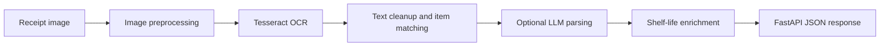

# FreshTrack AI Module

OCR + LLM-enhanced parsing FastAPI service for turning grocery receipt images into structured JSON outputs with confidence scoring and shelf-life lookup.

> Portfolio demo only. This is a production-style reference implementation, not a live production integration. Do not upload or commit sensitive receipts, payment data, personal data, API keys, or private documents.

## Problem

Receipt OCR is noisy: store names, addresses, totals, payment lines, and manager names can be misread as grocery items. This project demonstrates a document/vision extraction pattern that combines OCR cleanup, domain matching, optional LLM-assisted parsing, and API-first JSON contracts.

## Architecture



## What It Demonstrates

- FastAPI service design with API docs.
- OCR preprocessing and text parsing.
- Optional LLM-assisted filtering for false-positive reduction.
- USDA FoodKeeper-style shelf-life enrichment.
- Confidence scoring and frontend-ready response contracts.
- Dockerized service variants for local development.

## Quick Start

### Docker

```bash
git clone https://github.com/smgpulse007/FreshTrackAIModule.git
cd FreshTrackAIModule
cp .env.example .env
docker compose up api-production -d
curl http://localhost:8004/api/v1/health
```

### Local Python

```bash
python -m venv .venv
.\.venv\Scripts\activate
pip install -r requirements.txt
uvicorn app.api_main:app --host 0.0.0.0 --port 8004
```

For optional LLM parsing:

```bash
pip install -r requirements-llm.txt
uvicorn app.llm_main:app --host 0.0.0.0 --port 8005
```

Set `OPENAI_API_KEY` only in your local environment or `.env`; never commit real keys.

## API Examples

```bash
curl -F "file=@tests/sample_receipt.jpg" http://localhost:8004/api/v1/receipt/process
```

Main endpoints:

| Method | Endpoint | Purpose |
| --- | --- | --- |
| `POST` | `/api/v1/receipt/process` | Process a receipt image |
| `GET` | `/api/v1/food-database` | Return shelf-life reference data |
| `GET` | `/api/v1/categories` | Return food categories |
| `GET` | `/api/v1/health` | Health check |

Interactive docs run at `http://localhost:8004/docs`.

## Validation

```bash
python -m pytest tests
python -m compileall app scripts
```

Some OCR/LLM checks may require local Tesseract binaries or optional LLM dependencies.

## Privacy And Safety

- The checked-in test receipt is synthetic/sample test data.
- Do not commit uploaded receipts or `.env` files.
- Treat receipt images as potentially sensitive because they can contain store, payment, timestamp, or location details.
- Review extracted output before storing or using it downstream.

## Limitations

- Optional OpenAI-backed parsing requires a locally supplied API key.
- OCR quality depends on image resolution, lighting, receipt formatting, and Tesseract availability.
- The Supabase/frontend references are integration patterns, not a hosted production deployment.
- No production authentication, tenant isolation, audit logging, or retention policy is included.

## Portfolio Relevance

Demonstrates OCR cleanup, LLM-assisted parsing, confidence scoring, API design, Dockerized service delivery, and frontend-ready JSON contracts that transfer to regulated document AI workflows.

## License

MIT License. See [LICENSE](LICENSE).
