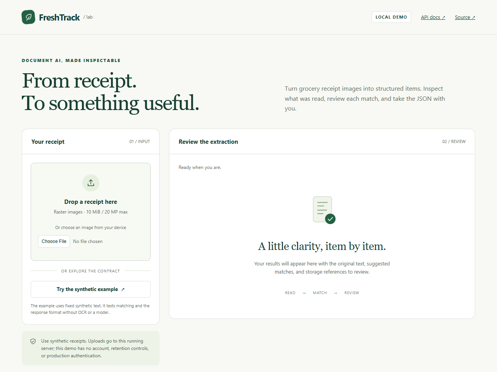
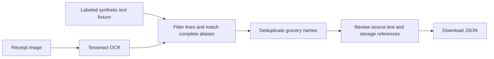

# FreshTrack Lab

Turn a grocery receipt into inspectable JSON: **read the image, review each match, export the result.** A small FastAPI app with a browser interface, local Tesseract OCR, and deterministic grocery matching.

No API key or model download is needed for the primary app. The built-in synthetic example runs without the Tesseract binary, and clearly identifies itself as a text fixture rather than OCR output.



Recorded from the running app with its labeled synthetic fixture; this flow does not run OCR. [Recording details](docs/record-demo.md) · [Still image](docs/receipt-demo.png)

## Try it locally

Python 3.11 is the tested runtime. Create and activate a virtual environment:

```bash
python -m venv .venv
# macOS/Linux
source .venv/bin/activate
# Windows PowerShell, instead
.\.venv\Scripts\Activate.ps1
```

Then install and start:

```bash
python -m pip install -r requirements-api.txt
python -m uvicorn app.api_main:app --host 127.0.0.1 --port 8004
```

Open **http://127.0.0.1:8004** and choose **Try the synthetic example**. Review the source lines, matching labels, and storage references, then download JSON. API docs are at `/docs`.

To extract an image, install the [Tesseract binary](https://tesseract-ocr.github.io/tessdoc/Installation.html) and put it on `PATH`; `pytesseract` alone does not include it. Use synthetic images without personal or payment data. A missing binary produces an actionable `503` response. Docker includes Tesseract:

```bash
docker build -f Dockerfile.api -t freshtrack-api .
docker run --rm -p 127.0.0.1:8004:8000 freshtrack-api
```

## How it works



The browser is a self-contained HTML/CSS/JavaScript page with no external fonts, analytics, or UI build step. Requests stay between the browser and the running API. The UI and API share an origin; cross-origin browser access is not enabled by default. The API does not intentionally persist uploaded images; multipart handling may use temporary files. Deploying this app on another machine sends uploads to that server.

Matching uses complete aliases, preferring the longest phrase. For example, `WHOLE MILK 4.00` matches milk, `GV BUTTER 3.00` matches butter, and `PINEAPPLE` does not match the `apple` alias. This is a bounded rule system, not a trained classifier. Unsupported lines are omitted from matched items; the first 500 characters of extracted text remain available for inspection.

## API

| Method | Path | Behavior |
| --- | --- | --- |
| GET | `/` | Receipt review interface |
| POST | `/api/v1/receipt/demo` | Fixed synthetic text through the matching pipeline; no OCR |
| POST | `/api/v1/receipt/process` | Decode an image, OCR it, return matches and source lines |
| GET | `/api/v1/food-database` | Existing static storage reference table |
| GET | `/api/v1/categories` | Reference categories |
| GET | `/api/v1/health` | API liveness; does not certify OCR availability |

```bash
curl -X POST http://127.0.0.1:8004/api/v1/receipt/demo
curl -F "file=@synthetic-receipt.png" http://127.0.0.1:8004/api/v1/receipt/process
```

The response includes `items`, `raw_text_preview`, and `processing_info.mode`: `synthetic_fixture` or `uploaded_image`. Each item retains its source line. Confidence labels are heuristics, **not calibrated probabilities**. Empty or undecodable images return `400`, missing uploads `422`, and images exceeding 10 MiB or 20 megapixels `413`. OCR subprocesses have a 30-second timeout. The size check is an application-level image limit, not an HTTP gateway or rate limit.

## Run the checks

```bash
python -m pip install -r requirements-test.txt
python -m pytest -q
python -m compileall -q app scripts/smoke_receipt.py
```

The default suite targets the documented `app.api_main` entrypoint and deterministic matching: synthetic fixture labeling, image decoding, upload limits, OCR failure responses, alias boundaries, source evidence, deduplication, and reference endpoints. OCR is stubbed in unit tests; no model, API key, or external service is called.

The Docker CI job also runs `scripts/smoke_receipt.py` inside the container against port 8000. It generates a receipt image in memory and asserts that the real OCR upload route finds apples, bread, and milk. This small smoke fixture is not an accuracy benchmark.

Earlier experiments remain in the repository: `app.main` uses embedding/PaddleOCR services; `app.llm_main` has optional LLM integrations. The legacy `tests/test_api.py`, `tests/test_ocr.py`, and `tests/test_llm_service.py` are outside the default test selection because they need separate models, data, binaries, or running services. They are not validated by the lightweight suite. `requirements.txt` and `requirements-llm.txt` belong to those experiments; the primary app and its Docker image use `requirements-api.txt`.

## Scope and limitations

- Review every match. OCR quality depends on the image; the alias list is small and does not track quantities, prices, or every grocery category.
- The existing storage table is illustrative reference data, not a verified current FoodKeeper dataset or a food-safety assessment. Follow packaging and current authoritative guidance.
- No production authentication, tenant isolation, rate limiting, retention policy, or calibrated extraction accuracy is provided. Run locally for evaluation.
- Do not upload or commit private receipts, payment data, personal data, keys, or employer documents. The built-in text fixture and CI-generated image are synthetic; the provenance of older bundled receipt images has not been independently verified.
- No LLM is called in the primary API. Optional legacy OpenAI integrations require separate API credentials and may incur API charges; a ChatGPT subscription is not used by this app.

## License

[MIT](LICENSE).
